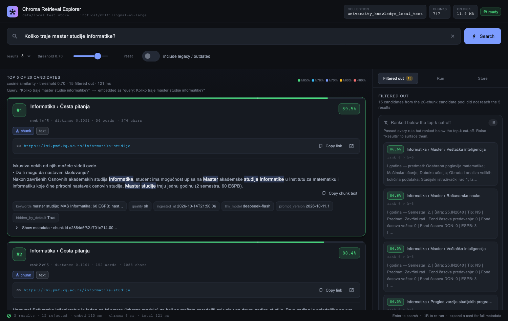
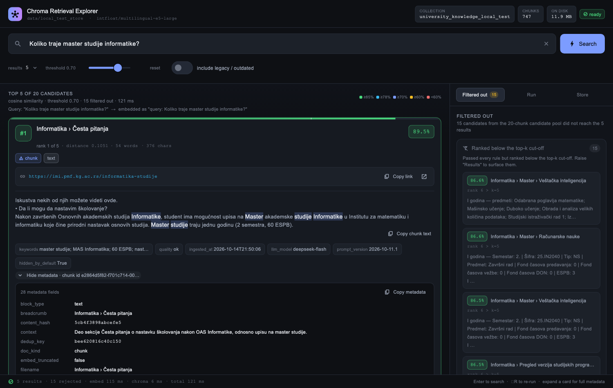

# IMI scraper → DeepSeek → ChromaDB

Fills the ChromaDB collection used by the chatbot (`imiChat`)
from the pages **you list in `links.txt`**.

The crawler and parser extract the page (tabs, tables, PDFs); **DeepSeek
V4.1 Flash then curates the actual content**: it decides what is knowledge,
discards navigation/boilerplate, rewrites where useful, and writes the final
self-contained RAG chunks.  Deterministic code keeps what the model must not
own: evidence checks, numeric-fact checks, the reviewed `programs.yaml`
versions, source URLs/breadcrumbs, deterministic chunk ids and safe storage.

## Why (what was wrong before)

| Problem | Cause | Fix here |
|---|---|---|
| "Koliko modula ima informatika?" → sometimes 2, sometimes 3 | `/informatika-studije` holds the 2026 program (2 modules), the 2019 program (3 modules) and 2011/2016 programs in tabs; they were flattened into unlabeled chunks | each tab panel is its own section; versions come from the reviewed `programs.yaml` (year + status `enrolling / phase_out / upcoming / legacy / unknown`, written into every chunk's metadata and header); a verified "Pregled verzija" chunk per program; the chatbot drops legacy versions unless asked |
| Link wrong / text not findable on the page | `?osnovne`, `?master`, `?doktorske` are the same page — indexed 4×, last URL won; hidden tabs; copy-pasted panels nobody can open; PDFs without page numbers | canonical URLs; breadcrumb per chunk (`Informatika › Osnovne (Upis 2026/27) › Računarske nauke`); `url` opens the right tab (probe-verified `?param`); unreachable panels are not indexed; `file.pdf#page=N` |
| Course tables unreadable | rowspan/colspan flattened to `1. 1. 25.IN1073 TM … 2 2 0 6` | rows rendered with column names: `I godina — Semestar: 1. \| Šifra: 25.IN1073 \| … \| ESPB: 6`; 1–2 rows per chunk, embedded together with "Koliko ESPB ima predmet X?"-style questions (a course question hits its row) + one "predmeti: …" name list per year for listing questions |
| Site text that is itself outdated (FAQ still says "3 smera") | no notion of what is current | DeepSeek compares curated chunks that are not tied to a program version with the reviewed program facts → `outdated=true`, a warning in the header, hidden by the chatbot unless old programs are asked about |
| Noise, menus, duplicated panels in the vector store | deterministic splitting indexed everything | DeepSeek curates each section: navigation/boilerplate/duplicates are discarded and reported, only knowledge becomes a chunk |
| Stale chunks | nothing ever deleted | per-page upsert, then stale ids of that page are deleted; a **partial** page is not committed (or, with `--allow-partial-write`, is upserted without deleting anything) |

## Setup

```bash
conda env create -f environment.yml     # creates the `imi` env (Python 3.10)
conda activate imi
cp .env.example .env                    # then put your DEEPSEEK_API_KEY in .env
```

`environment.yml` keeps `numpy`/`scipy` on conda-forge and everything else
from PyPI, with `constraints.txt` vetoeing pip's transitive upgrades.  Both
pins work around macOS-27 breakage in the *newest* PyPI wheels:

| Package | Pin | Why |
|---|---|---|
| `scipy` | `1.15.3` (conda-forge) | the PyPI macOS-arm64 wheel fails to `dlopen` (`_spropack…so`: *"section `__DATA/__thread_bss` has a zero-fill section type, but offset field is not zero"*), which takes `scikit-learn` → `sentence-transformers` → `chromadb` down with it |
| `torch` | `2.12.0` (PyPI) | 2.13+/2.14 bundle their own `libomp`, which collides with conda-forge's `llvm-openmp`: *"OMP: Error #15 … already initialized"*, and `KMP_DUPLICATE_LIB_OK=TRUE` segfaults mid-encode |

Both are the versions proven working in the sibling `university-scraper`
project.  On Linux/Windows neither pin is needed — drop them from
`constraints.txt` and `environment.yml` if you hit a conflict.

`DEEPSEEK_API_KEY` enables AI curation (the default `ingest`).  Without it,
`run.py ingest --no-llm` still works: the crawler/parser, the registry and the
deterministic chunker produce chunks (no AI rewriting, reporting says
`Curation: deterministic`).  Because `config/settings.py` reads `.env` via
pydantic-settings, the key never has to be committed — `.env` is git-ignored.

### Where the vector DB lives

The Chroma index is **inside this project**: `data/vector_store/`
(`VECTOR_DB_PATH=./data/vector_store` in `.env`).  Nothing has to be copied in
from another checkout any more — `python run.py ingest` creates the folder on
the first run and writes every chunk there.  Relative paths resolve against the
project root, so it works from any working directory.  See
[`data/vector_store/README.md`](data/vector_store/README.md) for what the files
are.

To share **one** index with the chatbot instead, point `VECTOR_DB_PATH` in
*both* projects at the same absolute path — e.g.
`VECTOR_DB_PATH=../university-chatbot/data/vector_store`.  The folder layout,
the cosine space and the E5 `passage: `/`query: ` prefixes are identical in
both projects, so either direction works.

`data/` is git-ignored (the index is a build artifact); only the folder's
README is tracked.  Deleting the folder is a safe "start over" — the next
ingest rebuilds it, and raw pages stay cached in `data/cache/http`.

`chromadb` is pinned to `1.5.9` here **and** in the chatbot — keep them equal.
The first real ingest downloads `intfloat/multilingual-e5-large` (~2.2 GB).
On CPU, embedding runs at roughly 0.5–1.5 s per chunk, so the first full run
of `links.txt` takes a while (set `EMBEDDING_DEVICE=cuda` if you have a GPU);
embeddings are cached, so later runs only embed what changed.

## Daily use

1. **Edit `links.txt`** — one URL (or local PDF/DOCX path) per line, `#` comments.
   Default: only that page.  Options: `https://… | depth=1 | docs=true`.
2. **Try it without touching anything**:
   ```bash
   python run.py ingest --links links.test.txt --dry-run
   ```
   Open `data/reports/<time>/report.md`: sections per page with version,
   status and link, what was **not** indexed and why, version maps,
   curation stats (sections processed/failed, chunks rewritten / deduplicated /
   rejected, original → curated size), discarded content, validation
   rejections, contradictions, chunk previews and token cost.
   `<time>/curation.json` has the same per-page data in machine-readable form;
   `<time>/chunks.jsonl` includes the curated document, evidence, source
   sections and whether each chunk was committed.
3. **Index into a test collection** and query it like the chatbot does:
   ```bash
   python run.py ingest --links links.test.txt --collection university_knowledge_test
   python run.py search "Koliko modula ima informatika?" --collection university_knowledge_test
   python run.py eval --collection university_knowledge_test
   ```
   To chat against it: `CHROMA_COLLECTION=university_knowledge_test` in the chatbot's `.env`.
4. **Production**: `python run.py` (= `ingest`, all of `links.txt`).
   **Stop / restart the chatbot around an ingest** (Chroma's local mode is
   not multi-process safe; each process caches the index).

Unchanged pages are skipped on the next run (DeepSeek answers and
embeddings are cached too, so re-runs are cheap).  `--force` re-processes.

| Command | What it does |
|---|---|
| `ingest [--links F] [--collection N] [--db-path P]` | crawl + index (default command) |
| `ingest --dry-run` | everything (including curation) except embedding / writing — report only |
| `ingest --no-llm` | deterministic pipeline: no page analysis, no AI curation, no rewriting |
| `ingest --allow-partial-write` | if some sections fail curation, upsert the successful ones without deleting old chunks (the page stays uncommitted and is retried) |
| `ingest --cached` | reuse raw pages from `data/cache/http` (iterate on parsing offline) |
| `ingest --keep-low-value` / `--include-unreachable` | keep what is normally dropped |
| `search "pitanje" [-k 5] [--include-legacy]` | chatbot-identical retrieval, prints chunks + distances |
| `eval [--file eval_questions.yaml]` | golden questions → hit@k / MRR |
| `ui [--collection N] [--db-path P] [--build]` | Flutter desktop app for visualising retrieval |
| `stats` | counts by status / page type / page |
| `remove <url or path>` | delete one page's chunks |

## Retrieval explorer (Flutter desktop app)

`ui/retrieval_explorer` is a macOS desktop app that shows **what the vector
store actually returns** for a question — the top-k chunks, each fully
structured, plus the candidates the retrieval policy threw away and why.

```bash
python run.py ui                        # starts the local API and opens the app
python run.py ui --build                # …and builds the release .app first
python run.py ui --db-path data/local_test_store \
                 --collection university_knowledge_local_test
python tools/retrieval_api.py           # backend only (any OS, no Flutter needed)
```



Each of the 5 result cards shows:
* **rank badge + similarity %** (colour-coded ramp) and a score bar with a
  marker at the similarity threshold, plus the raw cosine distance
* the **breadcrumb / page title** and the exact **URL**, with copy and
  "open in browser" buttons
* **tags** — `doc_kind`, program `status`, `outdated`, `version_label`,
  `block_type`, `embed_truncated`
* the **chunk text** with your query terms highlighted (diacritic-insensitive,
  so `skolarina` highlights `Školarina`), expandable to the complete embedded
  text — i.e. exactly the string the vector was built from
* **metadata chips** (keywords, quality, model, ingest time…) and a full
  key/value metadata table behind "Show metadata":



The right rail has three tabs:

| Tab | Contents |
|---|---|
| **Filtered out** | every rejected candidate grouped by reason — `below_threshold`, `legacy_or_outdated`, `duplicate`, `beyond_k` — with its score and the rule that dropped it |
| **Run** | the query funnel (returned → kept / below threshold / legacy / duplicate / beyond-k), timings for the E5 encode and the Chroma query, the `where` metadata filter, and the raw JSON |
| **Store** | the store folder, chunk count, on-disk size, embedding model and prefixes, the collections inside the folder, and facet counts + pages (loads on demand) |

Controls: top-k selector (3/5/8/10/20), threshold slider, "include legacy /
outdated" switch, collection selector, ⌘R to re-run, Enter to search.

### How it is wired

```
Flutter app (ui/retrieval_explorer)          Python backend (tools/retrieval_api.py)
  lib/api_client.dart  ──── HTTP JSON ────▶  GET  /api/health    store + collections + readiness
  lib/main.dart                               POST /api/search    results + rejected + timings
  lib/widgets/*                               GET  /api/stats     facet counts
                                              GET  /api/chunk/<id>
```

The backend is `http.server` + the *same* `RetrievalService` the CLI uses, so
the app cannot disagree with `python run.py search`; no web framework is
installed for it.  The E5 model is preloaded in a background thread at startup
(`--no-warm` disables that), which is why the header shows *loading E5 model…*
for the first few seconds.

Building the app needs the Flutter SDK (3.44+) and Xcode command-line tools:

```bash
cd ui/retrieval_explorer
flutter pub get
flutter test                      # parsing + widget tests, no backend needed
flutter build macos --debug       # → build/macos/Build/Products/Debug/*.app
```

`python run.py ui` uses an already built binary when one exists (Release, then
Debug), otherwise it falls back to `flutter run -d macos`.  The screenshots
above are regenerated with:

```bash
flutter test test/golden_capture.dart --update-goldens   # → ../../../docs/*.png
```

`release_unpack_macos` (the tool's universal-binary step) currently fails on
Xcode 27 with *"does not contain architectures arm64 x86_64"* — a Flutter
toolchain issue, not a project one; the debug bundle is a full desktop app and
is what `run.py ui` picks up here.  `MACOSX_DEPLOYMENT_TARGET` is pinned to
12.0 in `macos/Runner.xcodeproj` and forced onto every pod in `macos/Podfile`,
because Flutter's default 10.15 is outside Xcode 27's supported range.

## Program versions — `programs.yaml`

The registry is the single source of truth for "which program version is this
tab?".  It ships pre-filled for `informatika-studije` and `matematika-studije`
(entries marked `TODO verify` need a human check).  When a page has program
panels that are not in the registry, DeepSeek proposes entries — with quotes
from the page as evidence, which are checked — in `programs.draft.yaml`.
Review them and move them into `programs.yaml`.

Status is computed from the enrollment years and today's date:
`upcoming` (enrollment not started) → `enrolling` → `phase_out` (closed, but
earlier students still study by it) → `legacy`.  It moves on by itself, e.g.
matematika "Upis 2027/28" becomes `enrolling` in June 2027.

## What DeepSeek does

Model `deepseek-flash` (= DeepSeek-V4.1-Flash), non-thinking mode, strict JSON
output, temperature 0, cached in `data/cache/llm.sqlite`:

* **Call A — page analysis** (small, one per page): page type, summary,
  publication date, and registry drafts for program panels that are not in
  `programs.yaml` (every draft quote is checked against the page).  This call
  only receives an outline — it classifies the page and drafts registry
  entries, it does not curate content.
* **Call B — content curation** (one or more requests per page, **full section
  text**): DeepSeek receives every reachable section with its breadcrumb,
  registry version and complete extracted text (table rows keep their column
  names).  It returns the **final knowledge chunks**: Serbian Latin content,
  context, 2–4 student questions, keywords, verbatim `source_evidence`,
  quality, `outdated` for unversioned text, and a bounded list of discarded
  content with reasons.  It may rewrite for clarity but must preserve names,
  dates, deadlines, numbers, course codes, ESPB values, conditions,
  exceptions, negations and version-specific facts.  If a page is too large
  for one request, it is split at line/sentence boundaries; every part is
  processed and a missing part makes the page incomplete.
* **Reconciliation** (one extra call per multi-request page): a compact digest
  of the curated chunks is checked for cross-section duplicates and
  contradictions.  A duplicate is removed **only** if a deterministic
  near-duplicate check agrees; contradictions are reported, never silently
  resolved.

Storage and integrity stay deterministic:

* every chunk needs evidence that actually occurs in the extracted section;
* numbers / course codes in curated text must occur in the page corpus
  (`CURATION_STRICT_FACTS`, otherwise they are reported);
* version metadata always comes from `programs.yaml`, never the model;
* a section missing from the model reply, a rejected chunk with no
  replacement, or an empty unexplained section makes the page **incomplete** —
  it is not committed and the previous chunks are kept;
* `outdated=true` is only possible for text not tied to a program version, and
  an unversioned text whose module/smer count contradicts the currently
  enrolling registry program is flagged deterministically (e.g. the FAQ saying
  "3 smera" while the 2026 program has 2), even if the model only reported it
  as an issue.

The chatbot's LLM only ever sees the curated chunk plus its deterministic
header.  DeepSeek's context/questions/keywords are used for the embedding and
for diagnostics; they are never injected into the factual answer context.

Chunk size is configurable in `config/settings.py`
(`CURATION_CHUNK_MIN_TOKENS`, `CURATION_CHUNK_TARGET_TOKENS`,
`CURATION_CHUNK_MAX_TOKENS`) and enforced with the E5 tokenizer.  Content that
is still too long is split deterministically at sentence/table-row boundaries;
if the embedding input would exceed `EMBED_MAX_TOKENS`, the chunk is split
further instead of being silently truncated.

A cold-cache run of `/informatika-studije` produced 208 curated chunks from
26 sections in 24 requests (≈ $0.22, a few minutes); every validated reply is
cached in `data/cache/llm.sqlite`, so re-runs with unchanged source, prompt and
schema configuration make no API calls.  Cost scales with the total source
text, and the report always shows the actual token usage and estimate.

## Metadata per chunk

| Field | Example / meaning |
|---|---|
| `source`, `filename`, `type`, `page`, `url` | used by the chatbot's citations — `filename` is the tab path, `url` opens the tab |
| `page_url`, `breadcrumb`, `section_id`, `hidden_by_default` | exact location |
| `program`, `level`, `module`, `version_label`, `accreditation_year`, `valid_for`, `version_source` | `Informatika`, `osnovne`, `OAS Informatika — akreditacija 2026`, `upis od 2026/27`, `registry` |
| `status` | **always present** — `enrolling` / `phase_out` / `upcoming` / `legacy` from `programs.yaml`; `unknown` for text not tied to a version (FAQ, intro, news) and for generated version maps |
| `doc_kind`, `generated`, `block_type` | `chunk` or `version_map` (generated overview); `text` / `table` / `table_overview` / `curated` |
| `curated`, `curation_status`, `curation_version`, `page_curation_status` | AI curation provenance (`processed` / `no_relevant_content`; complete/partial page; deterministic with `--no-llm`) |
| `source_sections`, `source_evidence`, `rewritten`, `curation_issues` | traceability audit: sections and verbatim quotes behind the chunk, whether it was rewritten, validation notes |
| `page_type`, `published_date`, `context`, `questions`, `keywords`, `quality`, `issues` | DeepSeek curation (`context`/`questions` are embed-only, not part of the factual document) |
| `outdated`, `outdated_reason` | DeepSeek: contradicts the current program facts → hidden by the chatbot |
| `dedup_key`, `content_hash`, `also_on`, `prompt_version`, `llm_model`, `ingested_at`, `embed_truncated`, `embed_piece` | bookkeeping |

`status` is deliberately never `null`, so a metadata filter cannot silently
fall back to mixed old/new content.  Query only the currently enrolling
version with `where={"status": "enrolling"}`, or include general knowledge
with `where={"status": {"$in": ["enrolling", "unknown"]}}`.  The default
`CURRENT_ONLY_WHERE` drops only `legacy`, so `unknown` chunks are kept.
Re-ingest once after upgrading: `PIPELINE_VERSION` was bumped so pages that
already exist in a store are re-processed and get the field.

## Tests

```bash
conda activate imi
python -m pytest                 # scraper: offline, fixtures + fake DeepSeek/embedder
python tools/vector_store_demo.py   # smoke test: writes + queries the project's Chroma folder
```

Offline (saved pages in `tests/fixtures`, fake DeepSeek / embedder, real Chroma in a temp dir).
`tests/test_curation.py` covers the curation scenarios: noise removal, fact
preservation, separate program versions, curriculum tables, large pages split
across requests, hallucinated numbers/evidence rejection, partial failures
(without corrupting the store), idempotent re-runs, changed pages and retrieval.

The one exception is `tests/test_deepseek_live.py`, which calls the **real**
API.  It is skipped unless you opt in, so `pytest` never needs network or a key:

```bash
RUN_LIVE_LLM=1 python -m pytest tests/test_deepseek_live.py -v -s
```

Use it to check a new key or a changed `DEEPSEEK_MODEL`: it sends the real
curation prompt built by `prompts.curate_user`, asserts the key authenticates,
the model accepts the client's combined request shape, the reply validates
against the real `CurationResponse` schema, and that the SQLite cache serves
the second identical call without another API hit.  It is the only test that
needs network/API access; `pytest` without `RUN_LIVE_LLM=1` is fully offline.

The desktop app has its own tests:

```bash
cd ui/retrieval_explorer
flutter test                     # parsing + widget tests, no backend needed
flutter test test/live_api_test.dart   # end-to-end against a running tools/retrieval_api.py
```

`test/live_api_test.dart` skips itself when nothing is listening on
`127.0.0.1:8765`, so it is safe to run in a loop; start the backend with
`python tools/retrieval_api.py --no-warm` to exercise it.
